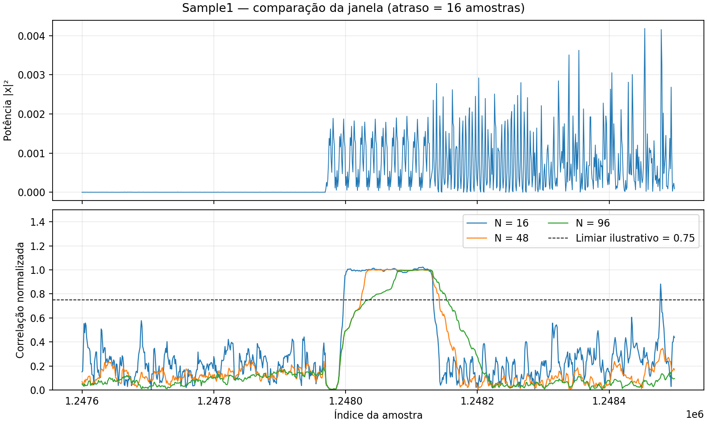

# Week 1 — deteção de tramas 802.11a

O objetivo desta semana é perceber os parâmetros do sinal OFDM e a primeira etapa do recetor do artigo de Bloessl et al.: detetar o início de uma trama pela repetição da sequência de treino curta. O sinal de entrada é complexo, com componentes I e Q. A deteção estudada aqui não descodifica, por si só, o conteúdo da trama.

## Parâmetros do 802.11a

| Parâmetro | Valor para um canal de 20 MHz |
|---|---:|
| Largura nominal do canal | 20 MHz |
| Frequência de amostragem | 20 MS/s |
| Tamanho da FFT/IFFT | 64 amostras |
| Espaçamento entre subportadoras | 20 MHz / 64 = 312,5 kHz |
| Subportadoras usadas | 52: 48 de dados e 4 pilotos |
| Posições FFT não usadas | 12: uma em DC e 11 nas extremidades |
| Duração útil de um símbolo OFDM | 3,2 µs, ou 64 amostras |
| Prefixo cíclico de um símbolo de dados | 0,8 µs, ou 16 amostras |
| Duração do símbolo com prefixo | 4 µs, ou 80 amostras |

Usando índices de frequência centrados em zero, as posições ativas vão de −26 a −1 e de +1 a +26. As quatro pilotos estão em −21, −7, +7 e +21; as restantes 48 transportam dados. As posições não usadas são a central, `0`, e as das extremidades, `−32` a `−27` e `+27` a `+31`. A posição central evita transmitir em DC; as posições laterais funcionam como bandas de guarda, ajudando a reduzir interferência fora do canal.

### Início da trama

O preâmbulo 802.11a inclui dois campos de treino, distintos do campo SIGNAL que vem a seguir:

- **Sequência de treino curta (L-STF):** 10 repetições de um padrão de 16 amostras; 160 amostras e 8 µs no total. É esta repetição que a deteção por autocorrelação procura.
- **Sequência de treino longa (L-LTF):** um intervalo de guarda de 32 amostras seguido de duas sequências de 64 amostras; também 160 amostras e 8 µs. Ajuda na sincronização e na estimativa do canal.
- **SIGNAL:** um símbolo OFDM de 80 amostras, ou 4 µs, que indica parâmetros necessários para interpretar o resto da trama. Não é a sequência curta usada no detetor desta semana.

As durações assumem 20 MS/s. Os dois campos de treino ocupam 16 µs; incluindo o SIGNAL, os campos iniciais ocupam 20 µs.

## Visão geral do recetor e tags — secção 2.1

A Figura 1 do artigo divide o recetor numa parte de deteção da trama e noutra de processamento e descodificação. Após detetar a sequência curta, as etapas seguintes fazem sincronização, correção de desvios, transformação FFT e descodificação.

Uma **stream tag** é metadado associado a uma posição específica de um fluxo de amostras ou de itens: contém um índice, uma chave e um valor, podendo também identificar o bloco de origem. A tag acompanha o fluxo; não é um campo adicional da própria amostra I/Q. O artigo refere tags para assinalar o início da trama e, mais à frente, a codificação e o comprimento obtidos do campo SIGNAL. Mensagens são um mecanismo diferente, assíncrono, útil para passar pacotes completos entre blocos.

Para localizar exemplos no código atual dos autores, na versão `maint-3.10`, o bloco [sync_short.cc](https://github.com/bastibl/gr-ieee802-11/blob/maint-3.10/lib/sync_short.cc) insere uma tag `wifi_start` com a estimativa de desvio de frequência. O [sync_long.cc](https://github.com/bastibl/gr-ieee802-11/blob/maint-3.10/lib/sync_long.cc) também insere `wifi_start` na saída depois da sincronização longa. Depois de descodificar o SIGNAL, [frame_equalizer_impl.cc](https://github.com/bastibl/gr-ieee802-11/blob/maint-3.10/lib/frame_equalizer_impl.cc) adiciona, entre outras, as tags `frame bytes` e `encoding`. Estes exemplos são da versão atual do projeto e não devem ser confundidos com uma lista exaustiva das tags da versão de 2013. O fluxo simplificado de deteção desta semana não implementa o recetor completo nem essas tags.

## Deteção por autocorrelação — secção 2.2

Como a sequência curta se repete a cada 16 amostras, comparamos o sinal com uma cópia atrasada de 16 amostras. Para cada amostra, multiplicamos um dos valores pelo conjugado do outro e somamos os produtos ao longo de uma janela com `NWin` amostras. O módulo dessa soma é a medida de correlação. Em paralelo, somamos a potência na janela e dividimos por ela:

```text
a[n] = soma(k=0..NWin-1) de x[n-k] * conjugado(x[n-k-16])
p[n] = soma(k=0..NWin-1) de |x[n-k]|²
c[n] = |a[n]| / p[n]
```

A expressão usa uma janela causal para o processamento em fluxo; a convenção de índices e de conjugação pode diferir da apresentada no artigo sem alterar o princípio da magnitude da correlação. O denominador normaliza a correlação pela potência, reduzindo a dependência da amplitude absoluta do sinal. Em implementações práticas pode juntar-se uma constante pequena ao denominador para evitar divisão por zero.

No diagrama, o ramo de autocorrelação é formado pelo atraso de 16 amostras, conjugação, multiplicação, soma deslizante e cálculo da magnitude. O ramo da potência usa magnitude ao quadrado e outra soma deslizante. Tal como na Figura 1 do artigo, cada soma é realizada por um filtro FIR com decimação 1 e `NWin` coeficientes iguais a 1 (`[1]*nwin`). O bloco de divisão combina os dois ramos. No início da sequência curta espera-se um patamar elevado em `c[n]`; fora dele, o coeficiente tende a ser menor, embora o ruído e outras partes da trama possam produzir valores elevados. O gráfico do coeficiente, por si só, não prova que uma trama tenha sido descodificada.

`NWin` controla quantos produtos entram em cada soma. O artigo apresenta 48 como valor que funcionou bem: a 20 MS/s corresponde a 2,4 µs. Uma janela maior tende a suavizar as flutuações, mas responde mais lentamente às transições e pode estreitar o patamar observado. Uma janela menor responde mais depressa, mas é mais sensível a flutuações. Estas são expectativas a comparar com os resultados da gravação, não conclusões experimentais antecipadas.

## Experiência e resultados

Foi analisado um excerto da gravação `Sample1_20MHz_Channel36.bin`, incluída no arquivo disponibilizado. O ficheiro foi interpretado como I/Q complexo, com dois valores `float32` little-endian por amostra. Esta interpretação é compatível com os dados observados, mas não havia metadados no arquivo para a confirmar. A taxa de 20 MS/s é indicada pelo nome da gravação.

Para comparar as janelas nas mesmas condições, usaram-se as amostras 1 247 600 a 1 248 499 (45 µs), com atraso de 16 amostras e `NWin` igual a 16, 48 e 96. O programa [compare_windows.py](experiments/compare_windows.py) calcula a mesma expressão do flowgraph e produz o gráfico abaixo. A linha de 0,75 é apenas uma referência visual, não um limiar validado de deteção.



| NWin | Duração da janela | Maior sequência acima de 0,75 neste excerto | Máximo neste excerto |
|---:|---:|---:|---:|
| 16 | 0,8 µs | 136 amostras (6,8 µs) | 1,023 |
| 48 | 2,4 µs | 119 amostras (5,95 µs) | 1,004 |
| 96 | 4,8 µs | 119 amostras (5,95 µs) | 1,001 |

Neste excerto vê-se um aumento da potência seguido de um patamar de correlação próximo de 1. A janela de 16 apresenta maiores oscilações fora do patamar; as janelas maiores suavizam a curva e a subida torna-se mais lenta. Os valores podem ultrapassar 1, sobretudo nas transições, porque o denominador usa a potência do sinal atual; não representam probabilidades. O patamar é compatível com uma sequência repetitiva como a de treino curta, mas não prova, isoladamente, a identidade ou descodificação de uma trama Wi-Fi. É um exemplo selecionado, não uma avaliação da taxa de deteção ou de falsos positivos.

O flowgraph foi compilado com GNU Radio 3.10.12. A seleção e a reprodução da gravação estão descritas no [README](README.md).

## Referências

- B. Bloessl, M. Segata, C. Sommer e F. Dressler, [An IEEE 802.11a/g/p OFDM Receiver for GNU Radio](https://doi.org/10.1145/2491246.2491248), SRIF, 2013, secções 2.1 e 2.2 e Figuras 1 e 2. Os autores também disponibilizam o [relatório técnico anterior](https://www.bastibl.net/bib/bloessl2013ofdm-tr/bloessl2013ofdm-tr.pdf), cuja paginação e numeração diferem da versão de conferência.
- Ana Aguiar, *Guide to Work through the 802.11a Receiver Article*, guia disponibilizado na unidade curricular, Week 1.
- [GNU Radio — Stream Tags](https://wiki.gnuradio.org/index.php/Stream_Tags).
- [MathWorks — L-STF e parâmetros de duração](https://www.mathworks.com/help/releases/r2023b/pdf_doc/wlan/wlan_ref.pdf) e [L-LTF](https://www.mathworks.com/help/wlan/ref/wlanlltfchannelestimate.html).

## Utilização de IA

Foi utilizado o ChatGPT para apoiar a consulta e organização dos conteúdos e a redação desta documentação.