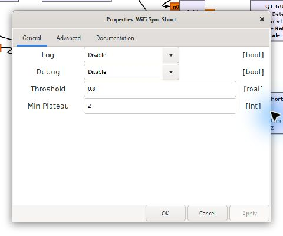
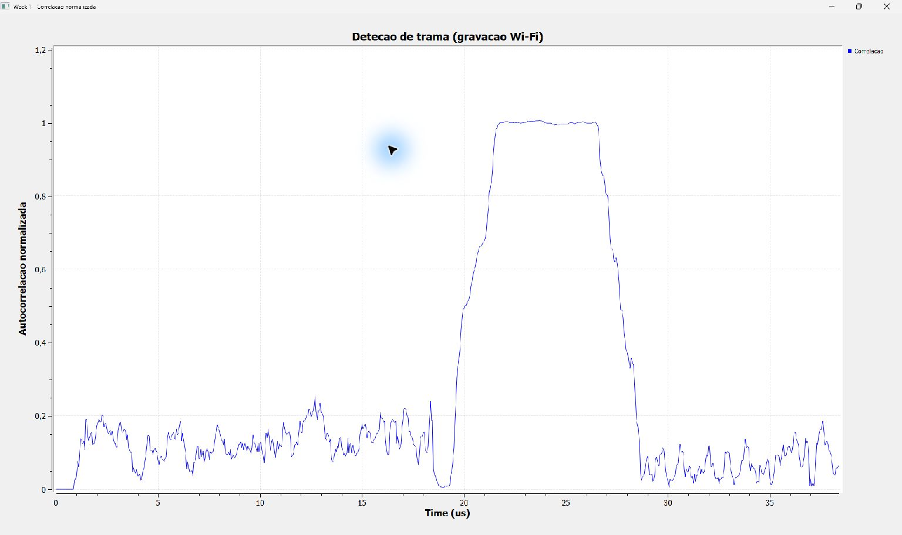
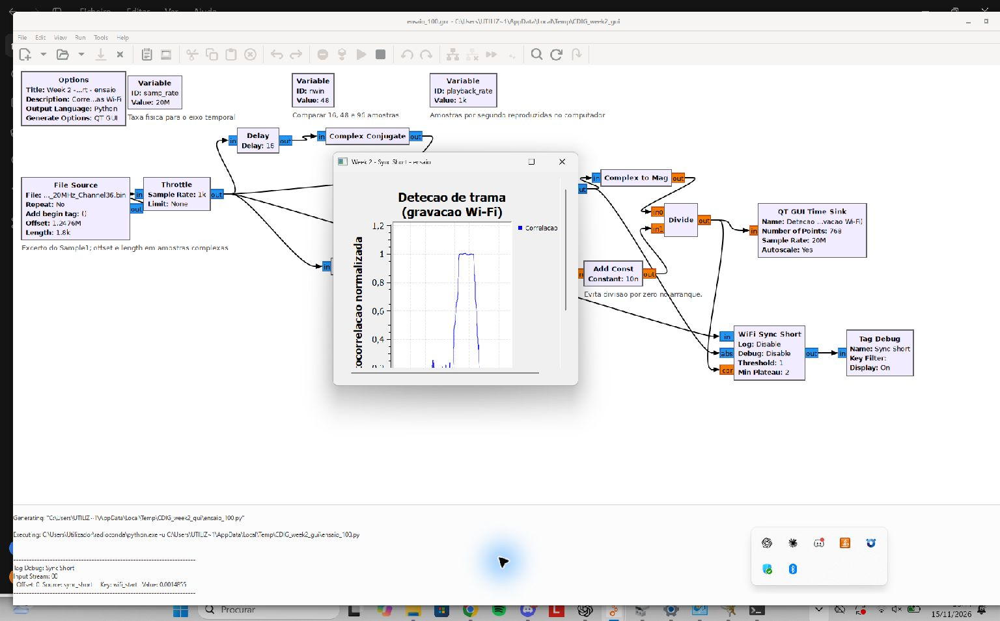
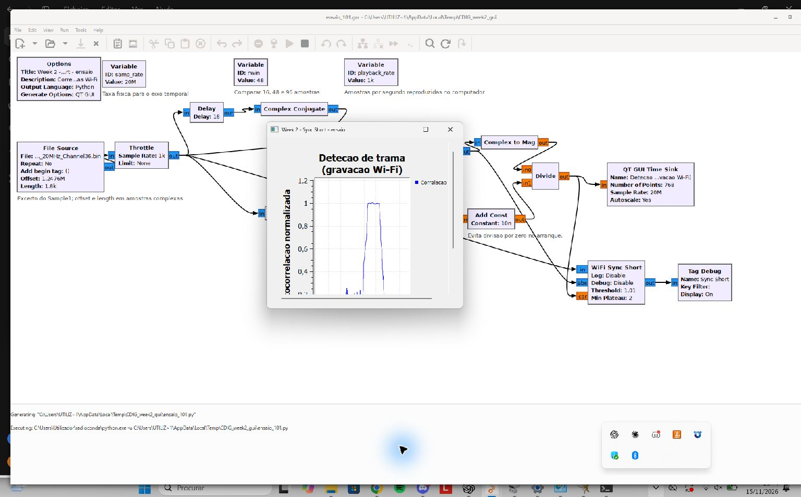
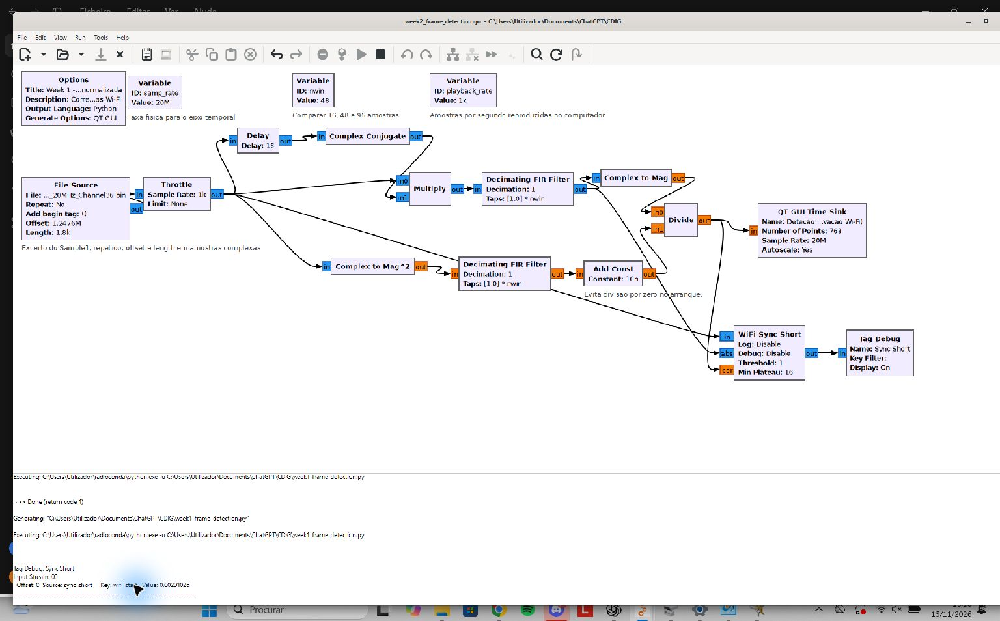
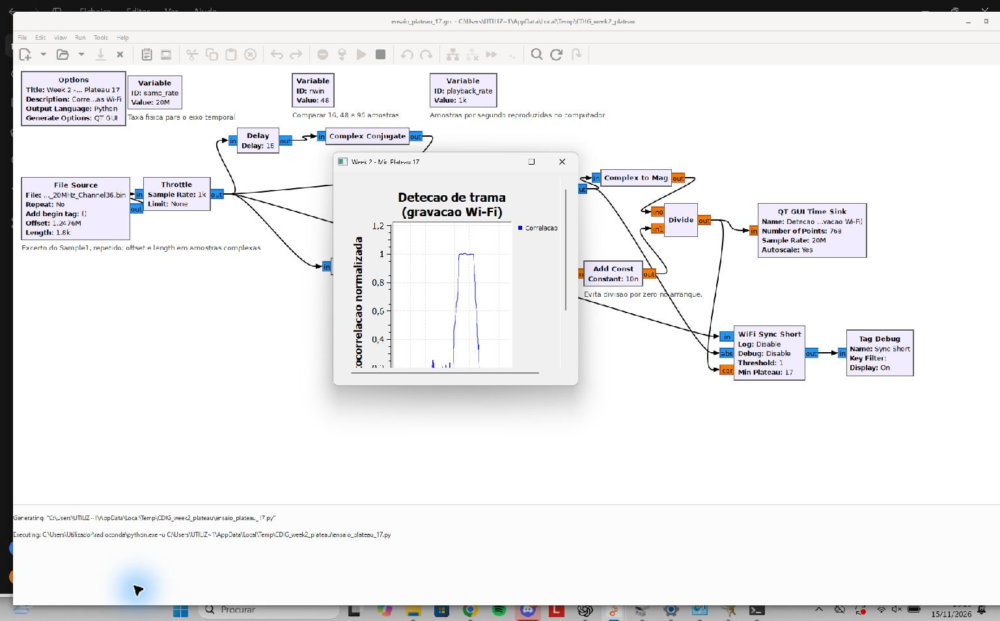

# Week 2 - deteção com o Sync Short

## Montagem

Partimos do fluxograma da Week 1 e acrescentámos o **WiFi Sync Short**, ligado a um **Tag Debug**. O Sync Short usa o sinal e a sua autocorrelação para procurar o início de uma trama. Quando há uma deteção, o Tag Debug mostra uma etiqueta `wifi_start`.

Usámos a gravação `Sample1_20MHz_Channel36.bin`, um atraso de **16 amostras** e `NWin = 48`. O fluxograma está em [week2_sync_short.grc](week2_sync_short.grc).

## Threshold e Min Plateau

O **Threshold** é o limiar que a correlação tem de ultrapassar. O **Min Plateau** indica a exigência de duração do patamar acima desse limiar. Nos testes iniciais usámos Min Plateau `2`; depois aumentámo-lo até `16`.

*O Threshold aceita valores decimais (`real`); o Min Plateau é inteiro (`int`).*

## Observações

O gráfico apresentou um patamar de correlação próximo de **1**, compatível com uma zona repetitiva do sinal.

Fomos aumentando o Threshold. Com **1.0** ainda apareceu uma etiqueta `wifi_start`; com **1.01**, deixou de aparecer output do Tag Debug. Para registar estes resultados, repetimos as duas execuções no GNU Radio, com a consola limpa em cada uma.

*Threshold `1.0`: é visível uma etiqueta `wifi_start` na consola.*

*Threshold `1.01`: não apareceu nenhuma etiqueta na consola durante esta execução.*

Os testes das duas imagens usaram o mesmo excerto: offset **1 247 600**, comprimento **1800 amostras**, `NWin = 48`, Min Plateau **2** e Repeat **No**. Entre os valores que testámos, **1.0 foi o maior em que observámos uma deteção**. Isto não é um limite geral: depende da gravação, do excerto e dos parâmetros.

O bloco procura várias amostras consecutivas acima do threshold. Por isso, um pico isolado pode ultrapassar o limiar sem gerar uma etiqueta.

### Aumentar o Min Plateau

Mantendo **threshold `1.0`** e o mesmo excerto, fomos aumentando o Min Plateau. Com **`16`** ainda observámos uma etiqueta `wifi_start`; com **`17`** já não apareceu nenhuma. Assim, `16` foi o último valor em que observámos uma deteção neste ensaio. O resultado depende do sinal e dos parâmetros escolhidos.

*A sessão com threshold `1.0` e Min Plateau `16`: a consola apresenta uma etiqueta. Pode também conter mensagens de execuções anteriores.*

*Comparação repetida com a consola limpa: com Min Plateau `17` não apareceu etiqueta.*

**Uma deteção não garante que exista uma trama válida.** Mesmo que haja amostras consecutivas acima do threshold e o bloco gere `wifi_start`, o sinal pode ter uma repetição por outra razão, como interferência. O Sync Short assinala um possível início; as etapas seguintes é que precisam de confirmar se os dados podem ser descodificados corretamente.

Com **Repeat = Yes**, o File Source volta a ler o mesmo excerto, pelo que etiquetas repetidas não demonstram necessariamente novas transmissões.

## O que vimos no código-fonte

Consultámos o código do bloco [`sync_short.cc` do gr-ieee802-11](https://github.com/bastibl/gr-ieee802-11/blob/maint-3.10/lib/sync_short.cc#L70-L89), na branch `maint-3.10`. As partes mais importantes para esta experiência são:

1. **Comparação:** `in_cor[i] > d_threshold` verifica se a correlação da amostra ultrapassa o threshold.
2. **Contagem:** `d_plateau++` aumenta o contador enquanto as amostras continuam acima do limiar; `d_plateau = 0` reinicia-o quando a condição falha.
3. **Deteção:** quando a condição do contador é satisfeita, `d_state = COPY` muda o bloco para o estado de cópia e é chamada a função `insert_tag(...)` para marcar a deteção.
4. **Etiqueta:** a função [`insert_tag`](https://github.com/bastibl/gr-ieee802-11/blob/maint-3.10/lib/sync_short.cc#L139-L146) cria a chave `wifi_start`; o valor associado é uma estimativa do desvio de frequência, não os dados da trama.

Um detalhe deste código é que o contador é verificado **antes** de ser incrementado. Na pesquisa inicial, com Min Plateau `16`, o contador chega a 16 e a deteção ocorre na amostra seguinte que continue acima do threshold. Por isso, neste código são necessárias **17 amostras consecutivas** acima do limiar para essa deteção. Consultámos a versão oficial `maint-3.10`; não confirmámos o commit exato do módulo instalado.

## Repetir a experiência

1. Criar a pasta `recordings` na pasta do projeto e colocar lá `Sample1_20MHz_Channel36.bin`. A gravação é obtida separadamente e não está no Git devido ao seu tamanho.
2. Abrir [week2_sync_short.grc](week2_sync_short.grc) no GNU Radio Companion. A cópia guardada está configurada para threshold `1.0` e Min Plateau `16`.
3. Limpar a consola, executar com **F6** e observar o Tag Debug. Alterar o Min Plateau para `17` e repetir.

Os prints estão também disponíveis como ficheiros PNG na pasta [prints/week2](prints/week2/).

## Utilização de IA

O ChatGPT ajudou a organizar o trabalho e o texto.
