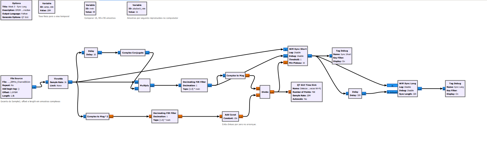

# Week 3 - Frequency Offset Correction

## Objetivo

Nesta semana, estudámos a secção 2.3 do artigo *An IEEE 802.11a/g/p OFDM Receiver for GNU Radio*, com o objetivo de compreender o funcionamento do bloco **OFDM Sync Long** e o algoritmo utilizado para corrigir o desvio de frequência (*Carrier Frequency Offset* - CFO).

Partimos do circuito desenvolvido na Week 2 e acrescentámos o bloco **WiFi Sync Long**, um atraso de 320 amostras e um segundo **Tag Debug**, para observar a informação de sincronização produzida pelos dois blocos. Acrescentámos ainda um **File Sink** para guardar os sinais de saída e comparar diferentes valores de atraso.



## Frequency Offset Correction

Quando um sinal é transmitido, o recetor deve estar configurado para a mesma frequência que o transmissor. No entanto, na prática, os osciladores dos dois equipamentos podem apresentar pequenas diferenças, fazendo com que as frequências não coincidam exatamente.

Esta diferença é conhecida como *Carrier Frequency Offset* (CFO) e provoca uma alteração progressiva da fase do sinal recebido, podendo afetar a correta recuperação dos símbolos OFDM. Por isso, é necessário estimar este desvio e compensá-lo.

Para isso, o algoritmo apresentado na secção 2.3 do artigo utiliza a sequência de treino curta (L-STF), que contém um padrão repetido a cada 16 amostras.

Como o padrão se repete, seria de esperar que duas amostras separadas por 16 posições apresentassem o mesmo valor. No entanto, quando existe um desvio de frequência, surge uma diferença de fase entre essas amostras.

É precisamente esta diferença de fase que permite estimar o desvio de frequência, através da equação (4):

$$
d_f = \frac{1}{16}\arg\left(\sum_{n=0}^{N_{\mathrm{short}}-17}s[n]\overline{s[n+16]}\right)
$$

Nesta equação, multiplicamos cada amostra pelo conjugado da amostra situada 16 posições à frente e somamos os resultados. A função $\arg$ permite obter a fase dessa soma e, dividindo por 16, obtemos uma estimativa da diferença de fase por amostra.

Depois de estimado o desvio, o sinal é corrigido através de uma rotação de fase no sentido contrário à provocada pelo CFO. Esta correção é representada pela equação (5) do artigo:

$$
s[n] \leftarrow s[n]e^{jnd_f}
$$

Desta forma, conseguimos reduzir o desvio de frequência antes de avançar para as etapas seguintes da sincronização.

## Implementação no GNU Radio

Na implementação atual do projeto `gr-ieee802-11`, a correção de frequência é realizada em duas etapas.

O bloco **WiFi Sync Short** utiliza a fase da autocorrelação da sequência curta para obter uma primeira estimativa do desvio de frequência. Esta estimativa é utilizada para corrigir inicialmente as amostras recebidas.

O bloco **WiFi Sync Long** utiliza posteriormente a sequência de treino longa (L-LTF) para continuar a sincronização e estimar um desvio residual de frequência.

Consultámos a implementação integrada neste repositório através dos seguintes ficheiros:

- [Montagem do Sync Short](week2_sync_short.grc), que instancia `ieee802_11.sync_short(1.0, 16, False, False)`;

- [Montagem do Sync Long](week3_sync_long.grc), que instancia `ieee802_11.sync_long(320, False, False)`;

- [Implementação Python gerada do Sync Short](week2_sync_short.py);

- [Implementação Python gerada do Sync Long](week3_sync_long.py).

No `sync_short.cc`, a estimativa inicial é calculada através da fase da autocorrelação complexa, dividida por 16:

```cpp
d_freq_offset = arg(in_abs[i]) / 16;
```

No `sync_long.cc`, a função `search_frame_start()` procura dois picos de correlação associados à sequência longa, normalmente separados por 64 amostras. A diferença de fase entre estes picos permite estimar o desvio residual de frequência:

```cpp
d_freq_offset = arg(first * conj(second)) / 64;
```

Esta implementação complementa o algoritmo descrito no artigo de 2013, que apresenta a correção de frequência utilizando a sequência curta.

## Delayed Input

Ao contrário do Delay de 16 amostras da Week 1, usado no cálculo da autocorrelação, este novo atraso serve para o alinhamento temporal do sinal.

O **WiFi Sync Long** possui duas entradas complexas:

- `in`: recebe diretamente a saída do WiFi Sync Short e é utilizada para procurar a sequência de treino longa.

- `in_delayed`: recebe uma cópia do mesmo sinal, atrasada através de um bloco Delay.

No circuito de referência, o atraso e o parâmetro `Sync Length` são ambos configurados para **320 amostras**. O `Sync Length` define o número de posições analisadas na pesquisa da sequência longa. O Delay tem o mesmo valor para que as amostras anteriores continuem disponíveis quando essa pesquisa termina.

**As 320 amostras não representam a repetição da sequência longa**, que ocorre a cada 64 amostras.

Considerando uma frequência de amostragem de 20 MHz, este atraso corresponde a:

$$
T = \frac{320}{20\times10^6} = 16\,\mu\text{s}
$$

A entrada atrasada permite conservar as amostras enquanto o bloco analisa o sinal e determina o alinhamento necessário. Depois da sincronização, o bloco utiliza esta entrada para produzir as amostras de saída.

Se alterarmos apenas o Delay, mantendo o Sync Length constante, as duas entradas deixam de apresentar o alinhamento temporal previsto. Isso pode levar à seleção de amostras incorretas e comprometer o processamento seguinte.

Se alterarmos ambos os valores, também modificamos a dimensão da janela utilizada na pesquisa de sincronização.

### Parâmetros que podemos variar

| Parâmetro | Efeito esperado |
|---|---|
| `Sync Length` | Modifica a duração da pesquisa da sequência longa. |
| `Delay` | Altera a posição temporal das amostras da segunda entrada. |
| `Threshold` e `Min Plateau` do Sync Short | Alteram os critérios de deteção inicial. |
| `NWin` | Altera a janela usada na autocorrelação da sequência curta. |

## Montagem e resultados iniciais

O circuito foi desenvolvido a partir do flowgraph da Week 2, utilizando a gravação `Sample1_20MHz_Channel36.bin`.

Para esta semana, acrescentámos os seguintes blocos:

| Bloco acrescentado | Função no circuito |
|---|---|
| **WiFi Sync Long** | Procura a sequência de treino longa para refinar a sincronização e estimar o desvio residual de frequência. |
| **Delay (320 amostras)** | Fornece ao Sync Long uma versão atrasada do sinal, permitindo recuperar as amostras necessárias depois da pesquisa. |
| **Tag Debug (Sync Long)** | Mostra na consola a tag `wifi_start` produzida pelo Sync Long. |
| **File Sink** | Guarda as amostras complexas de saída num ficheiro `.bin`, para comparar diferentes configurações. |

Mantivemos os seguintes parâmetros na configuração de referência:

| Parâmetro | Valor |
|---|---|
| Frequência de amostragem | 20 MHz |
| Atraso da autocorrelação | 16 amostras |
| NWin | 48 |
| Threshold do Sync Short | 1.0 |
| Min Plateau | 16 |
| Sync Length | 320 |
| Delay do Sync Long | 320 |
| Offset do File Source | 1 247 600 |
| Length do File Source | 1800 amostras |
| Repeat do File Source | No |

A saída do WiFi Sync Short foi ligada diretamente à primeira entrada do WiFi Sync Long e, através do bloco Delay, à segunda entrada.

Foram utilizados dois blocos Tag Debug para observar as etiquetas geradas pelas duas etapas de sincronização.

Após executar o circuito, obtivemos:

| Bloco | Tag | Valor observado |
|---|---|---:|
| WiFi Sync Short | `wifi_start` | 0.00201026 |
| WiFi Sync Long | `wifi_start` | 0.00268413 |

Os valores apresentados são estimativas angulares expressas em radianos por amostra. Na implementação consultada, a tag do Sync Long transporta a estimativa inicial combinada com a correção residual calculada pelo bloco.

Também observámos um patamar de autocorrelação normalizada próximo de 1, compatível com a presença da sequência de treino curta.

O aparecimento das duas etiquetas confirma que ambos os blocos produziram informação de sincronização durante a execução. No entanto, isto não demonstra, por si só, que a correção de frequência seja perfeita ou que a trama tenha sido descodificada corretamente.

## Experiência - Alteração do Delay

Para estudar o impacto da entrada atrasada, realizámos duas execuções com a mesma gravação, mantendo `Sync Length = 320` e alterando apenas o bloco Delay.

Acrescentámos um **File Sink** à saída do WiFi Sync Long para guardar os sinais produzidos em dois ficheiros binários:

| Experiência | Sync Length | Delay | Ficheiro |
|---|---:|---:|---|
| Referência | 320 | 320 | `output_320.bin` |
| Atraso alterado | 320 | 160 | `output_160.bin` |

Em ambas as execuções, os blocos produziram as mesmas etiquetas:

| Bloco | Delay = 320 | Delay = 160 |
|---|---:|---:|
| WiFi Sync Short (`wifi_start`) | 0.00201026 | 0.00201026 |
| WiFi Sync Long (`wifi_start`) | 0.00268413 | 0.00268413 |

Isto é compatível com o funcionamento do bloco: a pesquisa e a estimação do desvio de frequência são realizadas a partir da entrada direta, que não foi alterada neste teste.

Porém, ao comparar os ficheiros `output_320.bin` e `output_160.bin`, verificámos que as amostras complexas produzidas eram diferentes, apesar de ambos os ficheiros conterem **758 amostras**.

Na comparação das magnitudes, um alinhamento aproximado de **128 amostras no fluxo de saída** tornou as curvas bastante semelhantes (correlação de aproximadamente **0,94** na região comum). Esta diferença de posição na saída não tem de coincidir com a diferença de 160 amostras introduzida na entrada, uma vez que o Sync Long também seleciona e remove amostras durante o processamento.

Estes resultados mostram que o valor de Delay afeta o alinhamento e a seleção das amostras de saída, mesmo quando as etiquetas `wifi_start` permanecem iguais. A presença da tag, por si só, não garante que o sinal esteja corretamente alinhado para as etapas seguintes.

A experiência não demonstra isoladamente uma falha de descodificação, uma vez que essa etapa ainda não foi analisada.

## Experiência adicional - Alteração do Sync Length

Realizámos também um terceiro teste com **`Sync Length = 160` e `Delay = 160`**, para observar o efeito de reduzir a janela de pesquisa, mantendo os dois parâmetros com o mesmo valor.

Na consola, voltámos a observar `wifi_start = 0.00201026` no WiFi Sync Short e `wifi_start = 0.00268413` no WiFi Sync Long. Ou seja, **as estimativas indicadas pelas tags foram iguais nas três configurações**.

| Experiência | Sync Length | Delay | Tag Sync Short | Tag Sync Long |
|---|---:|---:|---:|---:|
| Referência | 320 | 320 | 0.00201026 | 0.00268413 |
| Delay alterado | 320 | 160 | 0.00201026 | 0.00268413 |
| Alteração conjunta | 160 | 160 | 0.00201026 | 0.00268413 |

Isto mostra que, para o excerto de sinal utilizado, reduzir a janela de pesquisa não alterou os valores apresentados nas tags.

**Ainda não comparámos as amostras de saída desta terceira configuração**, pelo que não podemos concluir que o alinhamento seja igual ao da configuração original.

## Comparison between Sync Short and Sync Long

Embora os dois blocos contribuam para a sincronização, têm funções diferentes:

| Característica | WiFi Sync Short | WiFi Sync Long |
|---|---|---|
| **Sequência utilizada** | Sequência curta (L-STF) | Sequência longa (L-LTF) |
| **Repetição relevante** | 16 amostras | 64 amostras |
| **Método principal** | Autocorrelação | Correlação com a sequência longa conhecida (*matched filter*) |
| **Função** | Detetar o início da trama e estimar o CFO inicial | Refinar a sincronização, estimar o CFO residual e preparar as amostras para o processamento seguinte |
| **Correção de frequência** | Primeira correção | Correção residual |

Resumindo, o Sync Short faz a deteção inicial, enquanto o Sync Long utiliza a sequência longa para melhorar a sincronização. Os dois blocos são complementares.

## Conclusão

Nesta semana, integrámos o WiFi Sync Long no circuito e estudámos o algoritmo de correção do desvio de frequência descrito no artigo, identificando também a sua implementação no código-fonte do recetor.

A análise mostrou que a estimativa inicial do CFO utiliza a fase da autocorrelação da sequência curta, enquanto o Sync Long pode estimar um desvio residual a partir da sequência longa.

A comparação entre os testes com Delay de 320 e 160 amostras mostrou que as etiquetas de sincronização permaneceram iguais, mas as amostras de saída foram alteradas. No terceiro teste, com Sync Length e Delay iguais a 160, as tags também mantiveram os mesmos valores.

Assim, a entrada atrasada tem um papel essencial no alinhamento temporal do sinal e a observação isolada de uma tag não é suficiente para validar o funcionamento completo do recetor.

## Referências

1. B. Bloessl, M. Segata, C. Sommer e F. Dressler, [*An IEEE 802.11a/g/p OFDM Receiver for GNU Radio*](https://doi.org/10.1145/2491246.2491248), 2013, secção 2.3.

2. [Implementação local dos blocos](week3_sync_long.py).

3. Ana Aguiar, *Guide to Work through the 802.11a Receiver Article*, Week 3.

## Utilização de IA

Foi utilizado o ChatGPT para apoiar a consulta do código-fonte, a interpretação dos resultados e a organização da documentação.
