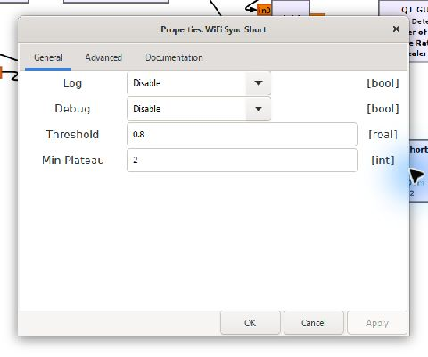
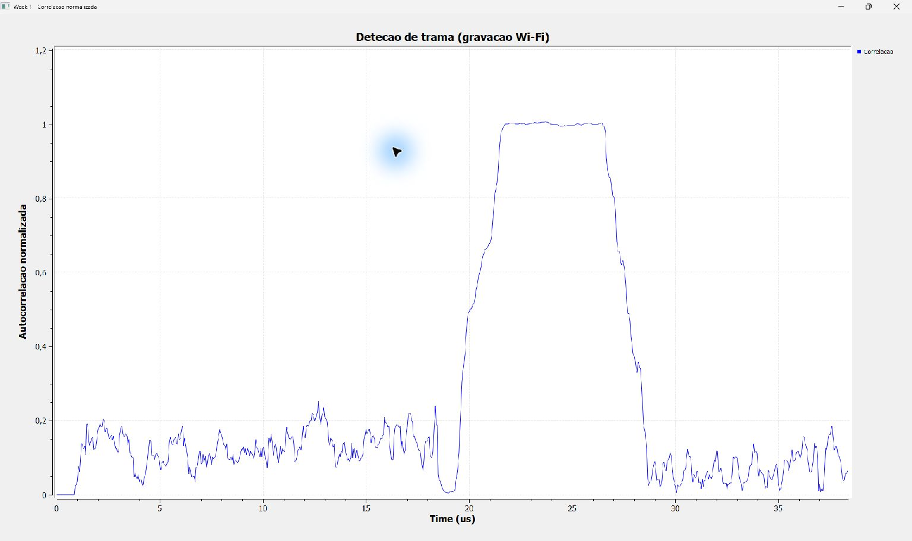
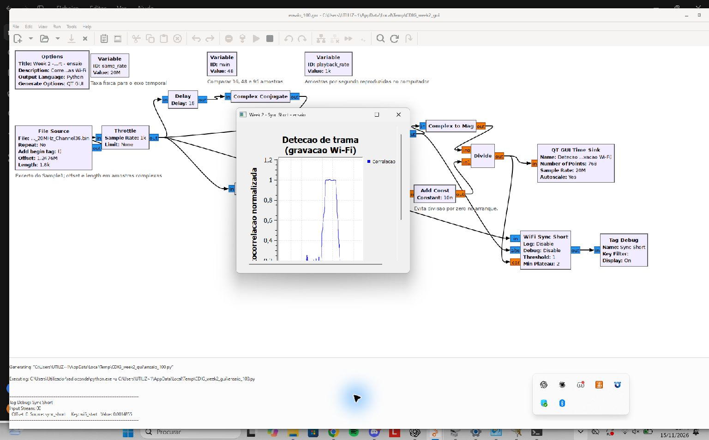
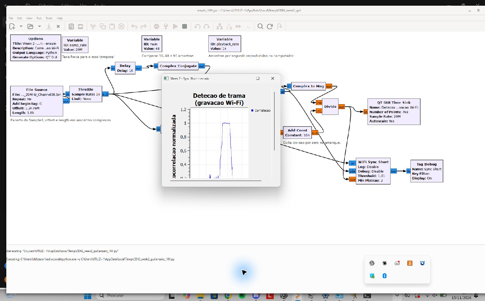

# Week 2 - deteção com o Sync Short

## Montagem

Partimos do fluxograma da Week 1 e acrescentámos o **WiFi Sync Short**, ligado a um **Tag Debug**. O Sync Short usa o sinal e a sua autocorrelação para procurar o início de uma trama. Quando há uma deteção, o Tag Debug mostra uma etiqueta `wifi_start`.

Usámos a gravação `Sample1_20MHz_Channel36.bin`, um atraso de **16 amostras** e `NWin = 48`. O fluxograma está em [week2_sync_short.grc](week2_sync_short.grc).

## Threshold e Min Plateau

O **Threshold** é o limiar que a correlação tem de ultrapassar. O **Min Plateau** indica a exigência de duração do patamar acima desse limiar. Nos testes iniciais usámos Min Plateau `2`; depois aumentámo-lo até `16`.

*O Threshold aceita valores decimais (`real`); o Min Plateau é inteiro (`int`).*

## Observações

O gráfico apresentou um patamar de correlação próximo de **1**, compatível com uma zona repetitiva do sinal.

Fomos aumentando o Threshold. Com **1.0** ainda apareceu uma etiqueta `wifi_start`; com **1.01**, deixou de aparecer output do Tag Debug. Para registar estes resultados, repetimos as duas execuções no GNU Radio, com a consola limpa em cada uma.

*Threshold `1.0`: é visível uma etiqueta `wifi_start` na consola.*

*Threshold `1.01`: não apareceu nenhuma etiqueta na consola durante esta execução.*

Os testes das duas imagens usaram o mesmo excerto: offset **1 247 600**, comprimento **1800 amostras**, `NWin = 48`, Min Plateau **2** e Repeat **No**. Entre os valores que testámos, **1.0 foi o maior em que observámos uma deteção**. Isto não é um limite geral: depende da gravação, do excerto e dos parâmetros.

O bloco procura várias amostras consecutivas acima do threshold. Por isso, um pico isolado pode ultrapassar o limiar sem gerar uma etiqueta.

### Aumentar o Min Plateau

Mantendo **threshold `1.0`** e o mesmo excerto, fomos aumentando o Min Plateau. Com **`16`** ainda observámos uma etiqueta `wifi_start`; com **`17`** já não apareceu nenhuma
