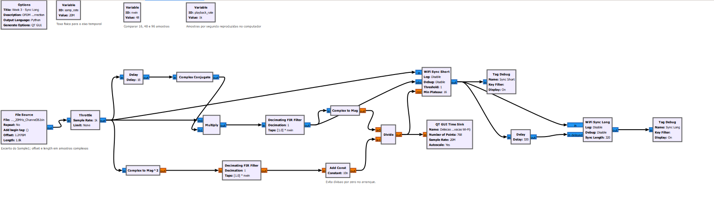
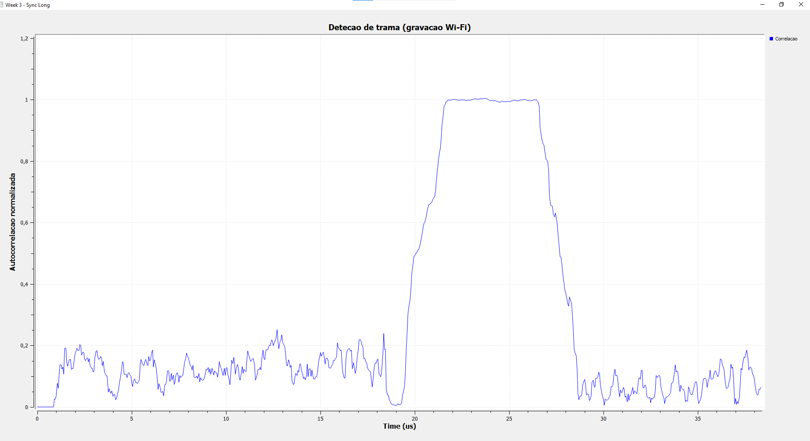

# Week 3 - Frequency Offset Correction

Partimos do circuito da Week 2 e acrescentámos o **WiFi Sync Long**, um **Delay de 320 amostras**, um segundo **Tag Debug** e um **File Sink**.

O objetivo desta semana foi estudar a correção do desvio de frequência (*Carrier Frequency Offset*, CFO) e perceber o funcionamento das duas entradas do Sync Long.

*Figura 1 — Circuito desenvolvido para a Week 3 no GNU Radio.*

O circuito está disponível em [week3_sync_long.grc](week3_sync_long.grc).

## Correção do desvio de frequência

O CFO resulta de pequenas diferenças entre as frequências dos osciladores do transmissor e do recetor. Esta diferença provoca uma rotação de fase no sinal recebido.

Na secção 2.3 do artigo, a estimativa é feita a partir da repetição de 16 amostras da sequência curta (L-STF). A diferença de fase entre essas amostras permite estimar o desvio através da equação (4):

$$
d_f = \frac{1}{16}\arg\left(\sum_{n=0}^{N_{\mathrm{short}}-17}s[n]\overline{s[n+16]}\right)
$$

Depois, a correção é aplicada através de uma rotação de fase, como indicado na equação (5):

$$
s[n] \leftarrow s[n]e^{jnd_f}
$$

Na implementação que utilizámos, o **Sync Short** faz a estimativa inicial do CFO e o **Sync Long** utiliza a sequência longa (L-LTF) para estimar o desvio residual.

O Sync Long tem duas entradas: `in`, que recebe diretamente a saída do Sync Short, e `in_delayed`, que recebe o mesmo sinal atrasado. O Delay permite manter disponíveis as amostras enquanto o bloco procura a sequência longa.

## Observações

Utilizámos a gravação `Sample1_20MHz_Channel36.bin`, com offset **1 247 600** e comprimento **1800 amostras**. Mantivemos `NWin = 48`, Threshold `1.0` e Min Plateau `16`.

Na configuração inicial, usámos **Sync Length = 320** e **Delay = 320**.

*Figura 2 — Autocorrelação normalizada durante a execução da Week 3.*

Observámos um patamar de correlação próximo de 1, entre aproximadamente 21 e 27 µs, compatível com a sequência curta (L-STF).

Após a execução, obtivemos as seguintes tags:

| Bloco | Valor de `wifi_start` |
|---|---:|
| WiFi Sync Short | 0.00201026 |
| WiFi Sync Long | 0.00268413 |

Os dois blocos produziram uma tag `wifi_start`, com valores associados à estimativa do desvio de frequência. No entanto, a presença destas tags não garante, por si só, que o sinal esteja corretamente alinhado.

### Alteração do Delay e do Sync Length

Para perceber melhor o efeito destes parâmetros, testámos três configurações:

| Teste | Sync Length | Delay |
|---|---:|---:|
| 1 | 320 | 320 |
| 2 | 320 | 160 |
| 3 | 160 | 160 |

Nas três execuções, os valores das tags mantiveram-se iguais.

Nos dois primeiros testes, guardámos as amostras de saída nos ficheiros `output_320.bin` e `output_160.bin`.

Ambos continham **758 amostras complexas**, mas os sinais não eram iguais. Ao comparar as magnitudes, verificámos que as curvas ficavam semelhantes após ajustar o alinhamento, obtendo uma correlação aproximada de **0,94** na região comum.

No terceiro teste, voltámos a observar as mesmas tags, mas não comparámos as amostras de saída.

Assim, verificámos que alterar o Delay pode modificar o sinal produzido pelo Sync Long, mesmo quando as etiquetas de sincronização permanecem iguais.

## O que vimos no código-fonte

Consultámos o código do [WiFi Sync Long](https://github.com/bastibl/gr-ieee802-11/blob/maint-3.10/lib/sync_long.cc), na branch `maint-3.10`.

As partes mais importantes para esta semana foram:

1. **Pesquisa da sequência longa:** a função `search_frame_start()` procura os picos de correlação associados à L-LTF.
2. **Separação dos picos:** `diff == 64` verifica se dois picos estão separados por 64 amostras.
3. **Estimativa do CFO residual:** `d_freq_offset = arg(first * conj(second)) / 64` utiliza a diferença de fase entre esses picos.
4. **Correção do sinal:** no estado `COPY`, o bloco aplica uma rotação de fase às amostras da entrada atrasada.

A consulta deste código ajudou-nos a perceber porque é que o Sync Long utiliza a sequência longa e qual a função do Delay no processamento.

O ficheiro [week3_sync_long.py](week3_sync_long.py) contém o Python gerado pelo GNU Radio para o circuito.

## Utilização de IA

O ChatGPT foi utilizado como apoio na interpretação do código e na organização da documentação.
