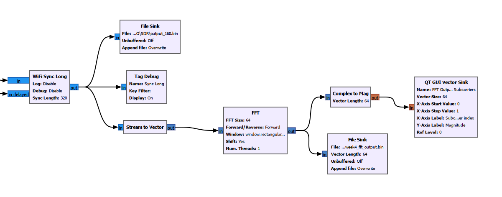
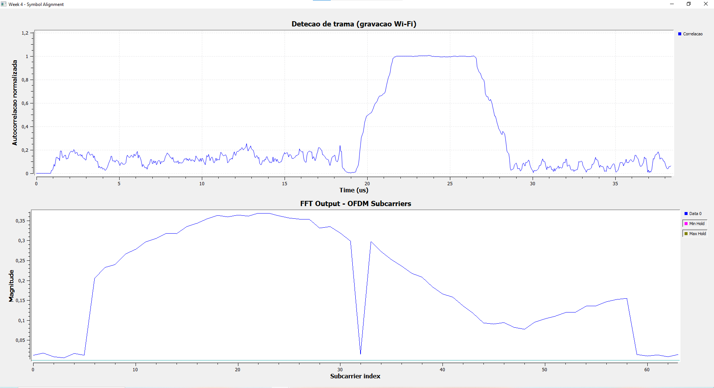

# Week 4 - Symbol Alignment

Partimos do circuito da Week 3 e acrescentámos um **Stream to Vector**, uma **FFT de 64 pontos**, um **Complex to Mag** e um **QT GUI Vector Sink**. Ligámos também um **File Sink** à saída da FFT para guardar os resultados complexos.

A Figura 1 apresenta apenas a parte do circuito trabalhada nesta semana, incluindo os novos blocos ligados à saída do WiFi Sync Long. O restante circuito manteve-se igual ao das semanas anteriores.

*Figura 1 — Parte do circuito desenvolvida na Week 4.*

O circuito completo está disponível em [WEEK4.grc](WEEK4.grc) e o Python gerado pelo GNU Radio em [WEEK4.py](WEEK4.py).

## Alinhamento dos símbolos

Nesta semana, estudámos o alinhamento dos símbolos OFDM, descrito na secção 2.4 do artigo.

O **WiFi Sync Long** utiliza *matched filtering* para localizar a sequência de treino longa (L-LTF), comparando o sinal recebido com uma sequência conhecida. Como a L-LTF contém duas repetições de 64 amostras, o bloco procura picos de correlação separados por essa distância.

Cada símbolo OFDM de dados contém **80 amostras**: 16 de prefixo cíclico e 64 úteis. Após localizar o início dos símbolos, o Sync Long descarta o prefixo cíclico, mantendo as amostras necessárias para a FFT.

O **Stream to Vector** agrupa estas amostras em vetores de 64. A FFT transforma cada vetor para o domínio da frequência, permitindo obter os valores complexos das subportadoras OFDM.

Para visualizar os resultados, utilizámos um **Complex to Mag** e um **QT GUI Vector Sink**, ambos configurados para trabalhar com vetores de 64 elementos.

## Observações

Utilizámos a gravação `Sample1_20MHz_Channel36.bin`, com offset **1 247 600**, comprimento **1800 amostras** e `Repeat = No`. Mantivemos **Sync Length = 320** e **Delay = 320**.

Depois de executar o circuito, obtivemos os seguintes gráficos:

*Figura 2 — Autocorrelação normalizada e magnitudes das 64 posições da FFT.*

No gráfico superior, observámos um patamar de autocorrelação próximo de 1, compatível com a sequência curta (L-STF).

No gráfico inferior, verificámos magnitudes reduzidas nas extremidades e na posição central (índice 32), correspondentes às posições não utilizadas na transmissão OFDM. A FFT foi configurada com `Shift = Yes`, colocando a posição DC no centro do vetor.

Acrescentámos ainda um File Sink para guardar os resultados complexos no ficheiro [week4_fft_output.bin](week4_fft_output.bin).

O ficheiro ficou com **5632 bytes**. Como cada valor `complex64` ocupa 8 bytes e cada vetor contém 64 valores, obtivemos:

$$
\frac{5632}{8\times64}=11\text{ vetores}
$$

Assim, confirmámos que o circuito produziu **11 vetores completos de 64 valores complexos**.

Os gráficos e o ficheiro de saída mostram que os dados estão a ser processados pela FFT. No entanto, ainda não permitem confirmar a descodificação correta da trama.

## O que vimos no código-fonte

Consultámos o ficheiro [`sync_long.cc`](https://github.com/bastibl/gr-ieee802-11/blob/maint-3.10/lib/sync_long.cc), na branch `maint-3.10`.

As partes mais relevantes para esta semana foram:

1. **Matched filtering:** o bloco utiliza a sequência longa conhecida para calcular a correlação com o sinal recebido.
2. **Alinhamento:** a função `search_frame_start()` procura dois picos separados por aproximadamente 64 amostras, permitindo localizar a L-LTF.
3. **Remoção do prefixo cíclico:** no estado `COPY`, o bloco mantém as primeiras 128 amostras úteis da L-LTF e, nos símbolos seguintes, descarta as primeiras 16 amostras de cada grupo de 80.

No Python gerado pelo GNU Radio, confirmámos também a ligação:

`Sync Long → Stream to Vector (64) → FFT (64) → File Sink`

A saída da FFT está igualmente ligada ao Complex to Mag e ao QT GUI Vector Sink, permitindo observar as magnitudes das subportadoras.

## Repetir a experiência

1. Abrir [WEEK4.grc](WEEK4.grc) no GNU Radio Companion e verificar o caminho da gravação.
2. Confirmar `Offset = 1247600`, `Length = 1800`, `Repeat = No`, `Sync Length = 320` e `Delay = 320`.
3. Verificar que o Stream to Vector e a FFT estão configurados para 64 elementos, com a FFT no sentido direto e `Shift = Yes`.
4. Executar o circuito e observar os gráficos.
5. Confirmar a criação do ficheiro `week4_fft_output.bin` e verificar o seu tamanho.

## Utilização de IA

O ChatGPT foi utilizado como apoio na interpretação dos blocos e na organização da documentação.
