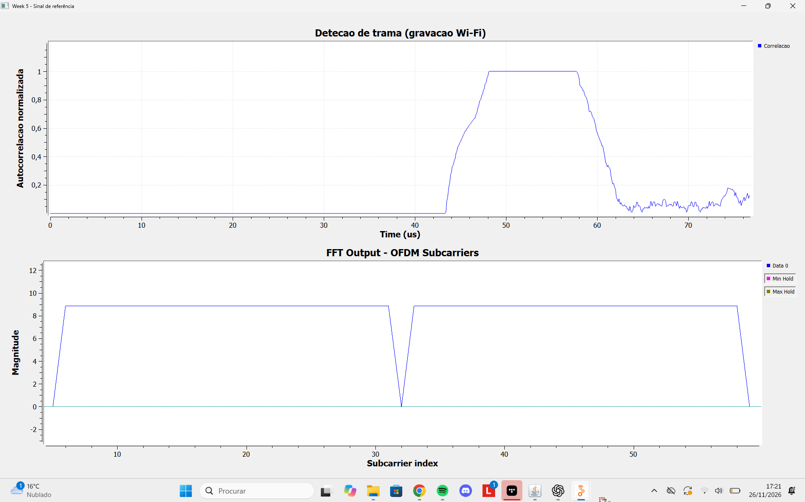
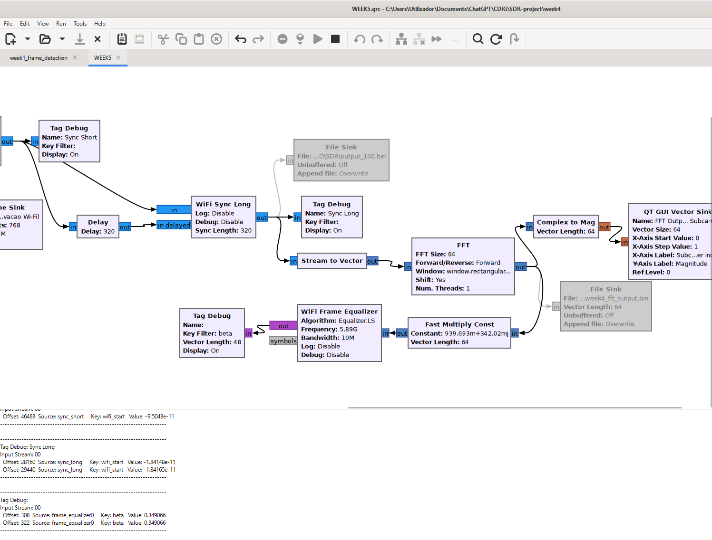
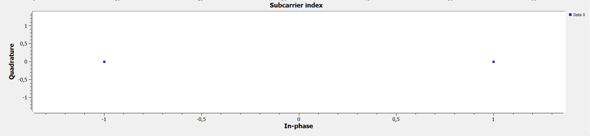
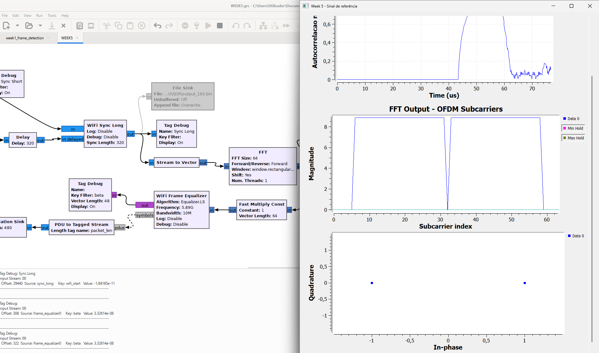

# Week 5 — resultados

## Como repetir o ensaio

Abre [WEEK5.grc](WEEK5.grc) no GNU Radio Companion 3.10 com o módulo `gr-ieee802-11` instalado. O [ficheiro de referência](week5_referencia.bin) contém 48 128 amostras complexas já prontas para ler. Mantém o `.bin` na mesma pasta que o `.grc`.

1. Com a constante `1+0j` no **Fast Multiply Const**, executa com **F6**. Procura a etiqueta `beta` na consola e observa a constelação.
2. Pára a execução, muda a constante para `0.9396926208+0.3420201433j` e volta a executar. Compara a etiqueta e a constelação com a referência.

## Referência antes da correção de fase

O recetor lê `week5_referencia.bin`, captado à saída do Packet Pad2, antes do canal simulado. A execução usa o limiar `0.8` no Sync Short e uma FFT de 64 pontos com `Shift = Yes`.

| Observação | Valor aproximado lido na captura |
|---|---|
| Patamar de autocorrelação normalizada | **1,0**, entre **48 e 58 µs** na janela mostrada |
| Magnitude nas subportadoras ativas | **8,9** no vetor FFT mostrado |
| Magnitude em DC (índice 32) e nas extremidades | Próxima de **0** |



O patamar é compatível com a repetição no preâmbulo e fica acima do limiar de deteção. A FFT mostra a distribuição das magnitudes nas subportadoras. O gráfico de magnitude descarta o ângulo dos valores complexos.

## Estimativa de fase

O Tag Debug, ligado à saída do WiFi Frame Equalizer (LS), mostra `beta`, a estimativa de fase para o símbolo SIGNAL, em radianos. O equalizador estima a rotação a partir dos pilotos nas subportadoras −21, −7, +7 e +21. Aplica a rotação inversa aos 64 valores da FFT multiplicando-os por `exp(−j·beta)`. [Código do equalizador](https://github.com/bastibl/gr-ieee802-11/blob/maint-3.10/lib/frame_equalizer_impl.cc)

Medimos primeiro a referência a **0° de rotação introduzida** para conhecer o valor inicial de `beta`. Na segunda execução usamos o mesmo ficheiro e inserimos um **Fast Multiply Const** entre a FFT e o equalizador. A constante `0.9396926208+0.3420201433j` é `cos(20°) + j·sin(20°)`. Tem módulo 1 e roda os 64 valores complexos de cada vetor, incluindo os pilotos, em **+20°** sem alterar as magnitudes.

| Rotação introduzida após a FFT | Etiquetas `beta` no registo | `beta` observado |
|---|---:|---:|
| 0° | 24 | `3.32614e-08 rad` em todas (aprox. 0°) |
| +20° | 24 | `0.349066 rad` em todas (aprox. +20°) |

A estimativa aumentou cerca de **0,349 rad**, de acordo com a rotação de **+20°** aplicada no ensaio.

Linha da consola desta execução:

```text
Offset: 0  Source: frame_equalizer0  Key: beta  Value: 3.32614e-08
```



## Constelação após a correção e a equalização

Com **+20°** introduzidos antes do equalizador, os pontos à saída `symbols` aparecem perto de **(−1, 0)** e **(+1, 0)**, as duas posições esperadas em BPSK. A janela mostra 480 valores complexos, o equivalente a 10 símbolos OFDM de dados com 48 subportadoras de dados cada. Vários valores ficam sobrepostos nas duas posições.



Repetimos o ensaio com os mesmos blocos e a constante `1+0j`, que introduz **0°** de rotação. As etiquetas visíveis voltaram a mostrar `3.32614e-08 rad` e a constelação apresentou as mesmas duas posições BPSK. Assim, a estimativa de fase acompanhou a alteração introduzida e a constelação, vista depois da correção e da equalização, ficou alinhada com o eixo real nas duas execuções.


