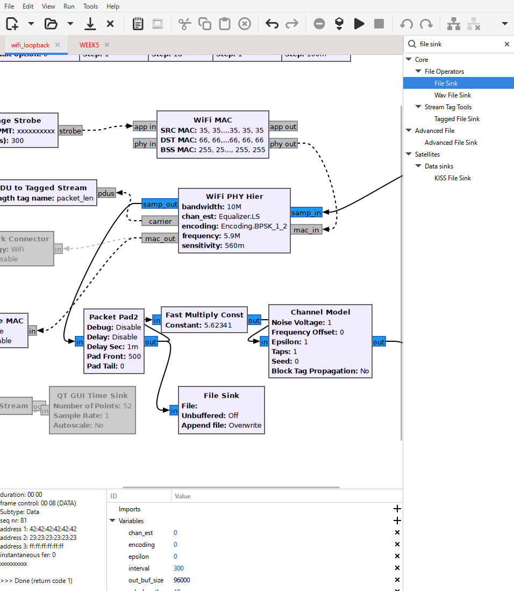

# Week 5 — resultados

## Sinal de referência

Na gravação real das semanas anteriores, o recetor podia estimar a fase usando os pilotos. Mas não tínhamos uma medição independente da rotação presente para confirmar o valor estimado. Escolhemos criar um sinal simulado como referência, sem o ruído do canal, e fizemos dois ensaios com o mesmo ficheiro. No segundo, acrescentámos +20° e comparámos a variação estimada pelo recetor com a rotação que introduzimos. Também seria possível acrescentar uma rotação conhecida à gravação real e comparar os valores de `beta`.

Partimos do [exemplo `wifi_loopback.grc`](https://github.com/bastibl/gr-ieee802-11/blob/maint-3.10/examples/wifi_loopback.grc), que gera tramas Wi-Fi. Ligámos um **File Sink** do tipo **Complex** à saída do **Packet Pad2**, que acrescenta amostras a zero antes de cada trama. Ao executar o loopback, gravámos as amostras em [week5_referencia.bin](week5_referencia.bin) antes de passarem pelo **Channel Model**, que acrescenta ruído.

*Montagem do ramo de captura, antes de preencher o caminho no File Sink.*

No **File Source** trocámos a gravação antiga pelo `week5_referencia.bin`. Na Week 4, o `Offset` saltava para a zona que queríamos estudar numa gravação longa. O novo ficheiro já contém só a captura de referência, por isso lemos desde a primeira amostra (`Offset = 0`) até ao fim (`Length = 0`). Assim, os dois ensaios recebem as mesmas amostras. Os +20° são introduzidos depois da FFT.

## Estimativa de fase

No [fluxograma da Week 5](WEEK5.grc), o **Fast Multiply Const** fica entre a FFT e o **WiFi Frame Equalizer**. Usámos a constante `1` para 0° e `0.9396926208+0.3420201433j` para +20°. Esta segunda constante tem módulo 1 e roda os valores complexos, incluindo os pilotos, sem alterar as suas magnitudes.

O recetor conhece os valores dos quatro pilotos. O equalizador compara os pilotos recebidos com os esperados para estimar a rotação e aplica o ângulo inverso, `−beta`, aos 64 valores de cada símbolo. O **Tag Debug** mostra o `beta` estimado para o símbolo SIGNAL, em radianos. [Código do equalizador](https://github.com/bastibl/gr-ieee802-11/blob/maint-3.10/lib/frame_equalizer_impl.cc)

| Rotação que introduzimos | Rotação estimada pelo recetor (`beta`) |
|---:|---:|
| 0° | `3.32614e-08 rad` (praticamente 0°) |
| +20° | `0.349066 rad` (aproximadamente +20°) |

Em cada execução apareceram 24 etiquetas com o mesmo valor. A estimativa passou de praticamente 0 para `0.349066 rad`: uma diferença de cerca de +20°, como esperávamos. As etiquetas correspondem às tramas processadas na mesma gravação, não a 24 ensaios independentes.

## Constelação após a correção e a equalização

Uma rotação de fase desloca os pontos da constelação, o que pode dificultar a distinção dos símbolos pelo recetor. Nos dois ensaios, os pontos à saída do equalizador ficaram perto de **(−1, 0)** e **(+1, 0)**, as posições esperadas em BPSK. O `beta` confirmou que a estimativa acompanhou a rotação introduzida. A constelação mostra o efeito conjunto da correção de fase e da equalização.

*Ensaio de referência a 0°.*

*Ensaio com +20° introduzidos.*

## Comparação adicional a realizar

Para visualizar o efeito no sinal, podemos observar as mesmas 48 subportadoras de dados do mesmo símbolo antes e depois do equalizador, mantendo a rotação de +20°. Esperamos vê-las rodadas à entrada e próximas das posições BPSK à saída. Esta comparação ainda não foi realizada. A saída do bloco inclui correção de fase e equalização, pelo que mostra o efeito conjunto das duas operações.

Outro ensaio possível é introduzir −20°. Nesse caso, prevemos um `beta` próximo de −0.349 rad. Ainda não medimos este caso.
